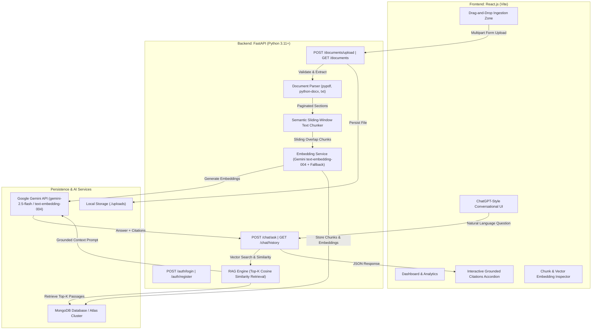

# DocuMind AI — Full-Stack AI Document QA Assistant (RAG + Gemini)

A production-ready, full-stack AI Document QA Assistant built from scratch using **React.js**, **FastAPI (Python)**, **MongoDB**, and **Google Gemini API**. Enables users to upload enterprise documents (PDF, DOCX, TXT), perform semantic vector retrieval, and interact through a grounded natural-language conversational interface.

---

## 🏛️ System Architecture & Data Flow



---

## ✨ Features

### 1. Document Ingestion & Parsing
* **Multi-Format Extraction:** Direct text extraction for `.pdf` (via `pypdf`), `.docx` (via `python-docx` including tables), and `.txt` / `.md` files.
* **Server-Side Validation:** Enforces MIME types, file extensions, and file size limits (`MAX_UPLOAD_SIZE_MB=20`).
* **Safe Local Storage:** Stores original documents in `./uploads` and cleans up associated files and vectors upon deletion.

### 2. Semantic Sliding-Window Chunking
* Splits text using a **700-character window** with **140-character overlap**.
* Preserves sentence structure (`. `, `? `, `! `) and paragraph boundaries (`\n\n`) to prevent fragmenting semantic meaning.
* Attaches essential metadata to every chunk: `document_id`, `owner_id`, `page_number`, `chunk_index`, and character counts.

### 3. Vector Embeddings & Similarity Search
* **Google Gemini Embeddings:** Uses the current official `google-genai` SDK with `text-embedding-004`.
* **Deterministic Fallback Vectorizer:** Includes an offline dense feature generator so similarity search works even if an API key is not yet configured.
* **Vector Similarity:** Computes cosine similarity via NumPy to retrieve top-$k$ relevant passages.
* **MongoDB Atlas Vector Search Ready:** Document chunks can be queried using cosine similarity in MongoDB Atlas or locally.

### 4. Grounded Answer Generation
* Constructs an executive prompt injecting retrieved passages with document and page annotations.
* System prompt strictly enforces grounding: answers only from document context and explicitly admits when information is missing.
* Defends against prompt injection contained within uploaded document contents.
* Generates answers using `gemini-2.5-flash`.
* Returns **transparent source citations**: document name, page number, relevance score (0–100%), and passage excerpt.

### 5. MongoDB Persistence & Authentication
* **Real Authentication:** Secure password hashing using `bcrypt` and signed JWT tokens (`pyjwt`).
* **Multi-Tenancy:** Strict authorization isolating documents, chunks, and chat history to their respective owners.
* **Collections:** `users`, `documents`, `document_chunks`, `conversations`, `messages`.
* **Resilient Fallback Engine:** Automatically detects if MongoDB is offline and activates a local JSON persistent store without crashing.

### 6. Modern Light-Theme Frontend
* Professional AI SaaS dashboard with a restrained **blue-and-white color palette**, subtle shadows, and rounded cards.
* **Dashboard View:** Stat cards, recent documents table, recent conversations list, quick upload.
* **AI Chat Interface:** ChatGPT-style layout, document scope filter (All Documents or specific file), Enter-to-send (Shift+Enter newline), loading pulse, copy-answer button.
* **Grounded Citations Accordion:** Collapsible source badges showing exact page numbers, similarity match, and quoted excerpts.
* **Chunk & Vector Inspector:** Visual modal to inspect segmented text chunks and character lengths.

---

## 🛠️ Technology Stack

| Layer | Technologies |
|---|---|
| **Frontend** | React 19, Vite, Lucide React, React-Markdown, Modern CSS3 |
| **Backend** | Python 3.11+, FastAPI, Uvicorn, Pydantic v2 |
| **AI / RAG** | Google Gemini API (`google-genai`), `text-embedding-004`, `gemini-2.5-flash`, NumPy |
| **Document Processing**| `pypdf`, `python-docx`, UTF-8 / Multi-encoding Python Text Engine |
| **Database** | MongoDB (`motor` async driver, `pymongo`), auto-fallback persistent store |
| **Security** | Bcrypt password hashing, Signed JWT Bearer Tokens (`pyjwt`) |

---

## 💻 Apple Silicon (MacBook Air M2) Setup Guide

### 1. Check Prerequisites
Open Terminal and verify your installed tools:
```bash
python3 --version   # Python 3.11 or higher
node -v             # Node.js 18 or higher
npm -v              # npm 9 or higher
```

### 2. Clone / Open Project Directory
```bash
cd "/Users/sanjay/AI Document QA Assistant "
```

### 3. Backend Setup
Create and activate a virtual environment, then install Python dependencies:
```bash
# Create virtual environment
python3 -m venv .venv

# Activate virtual environment
source .venv/bin/activate

# Install dependencies
pip install -r requirements.txt
```

### 4. Frontend Setup
Install frontend dependencies:
```bash
cd frontend
npm install
cd ..
```

### 5. Environment Variables Configuration
Copy the sample environment file:
```bash
cp .env.example .env
```

Edit `.env` with your preferred settings:
```ini
# Google Gemini API Key from Google AI Studio (https://aistudio.google.com/)
GEMINI_API_KEY=your_gemini_api_key_here

# Gemini Models
GEMINI_MODEL=gemini-2.5-flash
GEMINI_EMBEDDING_MODEL=text-embedding-004

# MongoDB URI (Atlas or Local)
# Note: If MongoDB is not running, the app automatically runs in resilient local fallback mode.
MONGODB_URI=mongodb://localhost:27017
MONGODB_DB_NAME=doc_qa_assistant

# JWT Security
JWT_SECRET_KEY=super-secret-doc-qa-jwt-key-2025

# Application Settings
FRONTEND_ORIGIN=http://localhost:5173
UPLOAD_DIR=./uploads
MAX_UPLOAD_SIZE_MB=20
```

---

## 🚀 Running the Application

### Option A: Unified One-Command Launch (Recommended)
Run the unified launch script:
```bash
./start.sh
```

### Option B: Separate Terminal Windows

**Terminal 1 — FastAPI Backend:**
```bash
source .venv/bin/activate
python backend/run.py
```
> Server running at: **http://127.0.0.1:8000**  
> Interactive OpenAPI / Swagger Docs at: **http://127.0.0.1:8000/docs**

**Terminal 2 — React Vite Frontend:**
```bash
cd frontend
npm run dev
```
> Web application running at: **http://127.0.0.1:5173**

---

## 🧪 Testing Instructions

Run the automated test suites:

```bash
# 1. Run RAG and unit tests (chunking, parsing, embeddings, auth)
.venv/bin/python backend/tests/test_rag.py

# 2. Run end-to-end API client tests (HTTP endpoints, upload, RAG ask, history)
.venv/bin/python test_api_client.py
```

### Manual Testing Walkthrough:
1. Open **http://127.0.0.1:5173** in your browser.
2. If not signed in, click **"Instant Demo Sign In (1-Click)"** (or create an account).
3. On the **Dashboard**, click **"Load Sample Documents"** (or go to **Documents** and drag-and-drop a `.pdf`, `.docx`, or `.txt` file).
4. Click **Inspect** on any document to view its individual chunks, page tags, and character counts.
5. Go to **AI Chat** and ask:
   - *"What are the core components of the RAG architecture?"*
   - *"What compliance frameworks were audited in the security report?"*
   - *"What is the remote work equipment stipend?"*
6. Review the grounded answer and expand the **"Grounded Sources"** accordion to verify the exact page numbers, similarity match scores, and quoted passages.

---

## 📡 REST API Reference

| Method | Endpoint | Description |
|---|---|---|
| `GET` | `/health` | Server health check and database status |
| `POST` | `/auth/register` | Register a new user (`email`, `password`, `username`) |
| `POST` | `/auth/login` | Authenticate user and receive JWT bearer token |
| `POST` | `/auth/demo` | Instant demo login for evaluation |
| `GET` | `/auth/me` | Fetch authenticated user profile |
| `POST` | `/documents/upload` | Upload PDF/DOCX/TXT; triggers parsing, chunking, and vector embedding |
| `GET` | `/documents` | List all documents belonging to the authenticated user |
| `GET` | `/documents/{id}` | Retrieve metadata for a specific document |
| `GET` | `/documents/{id}/chunks` | Inspect text chunks and metadata for a specific document |
| `DELETE` | `/documents/{id}` | Delete document, disk file, and associated chunk vectors |
| `POST` | `/chat/ask` | Execute RAG pipeline: retrieves top-k chunks, generates grounded answer, saves history |
| `GET` | `/chat/history` | List conversation summaries for the authenticated user |
| `GET` | `/chat/history/{conversation_id}` | Retrieve conversation turn history and source citations |
| `DELETE` | `/chat/history/{conversation_id}` | Delete a conversation session |
| `GET` | `/chat/status` | Retrieve system status, document count, and chunk count |

---

## ☁️ Deploying to Render (render.com)

DocuMind AI is pre-configured for **seamless zero-configuration deployment on Render's Free Tier** as a unified full-stack web service (FastAPI backend + Vite React SPA).

### Method 1: Automatic Blueprint (Easiest)
1. Push your repository to **GitHub**.
2. Go to the [Render Dashboard](https://dashboard.render.com/) and click **New +** → **Blueprint**.
3. Connect your GitHub repository.
4. Render will detect [`render.yaml`](file:///Users/sanjay/AI%20Document%20QA%20Assistant%20/render.yaml) and configure the web service automatically.
5. Provide your environment variables when prompted:
   - `GEMINI_API_KEY`: Your key from [Google AI Studio](https://aistudio.google.com/)
   - `MONGODB_URI`: Your MongoDB Atlas cluster connection string (optional; falls back to persistent store)
6. Click **Apply**. Render will build and deploy your live full-stack app!

---

### Method 2: Manual Web Service (Docker - Recommended)
1. In Render, click **New +** → **Web Service**.
2. Select your GitHub repository.
3. Configure the service settings:
   - **Name:** `documind-ai` (or your choice)
   - **Region:** Any (e.g. Oregon, Frankfurt)
   - **Branch:** `main`
   - **Runtime:** **Docker**
   - **Plan:** **Free**
4. Under **Environment Variables**, add:
   - `GEMINI_API_KEY`: `your_gemini_api_key`
   - `MONGODB_URI`: `your_mongodb_atlas_uri` (optional)
   - `JWT_SECRET_KEY`: `generate_a_random_secret_string`
   - `FRONTEND_ORIGIN`: `*`
   - `PORT`: `10000`
5. Click **Create Web Service**. Render builds the multi-stage Docker image and deploys your live application at `https://documind-ai.onrender.com`.

---

### Method 3: Native Python Runtime with `build.sh`
If you choose the native **Python 3** runtime on Render:
- **Build Command:** `./build.sh`
- **Start Command:** `uvicorn backend.app.main:app --host 0.0.0.0 --port $PORT`
- Render will execute [`build.sh`](file:///Users/sanjay/AI%20Document%20QA%20Assistant%20/build.sh), compile the React frontend into `frontend/dist`, and FastAPI will serve the full SPA.

---

## 🔒 Security & Reliability

* **Password Hashing:** Passwords are never stored in plaintext; hashed with `bcrypt` (12 rounds).
* **JWT Authorization:** Protected routes require `Authorization: Bearer <token>`.
* **Document Isolation:** Users can strictly retrieve and delete only documents and chunks they own (`owner_id` check).
* **Upload Safety:** File extension, MIME type, and size checks prevent malicious uploads.
* **Prompt Injection Defense:** Model is instructed to disregard prompt injection attempts embedded within document excerpts.
* **No Leaked Secrets:** API keys are read from environment variables on the backend and never exposed to the frontend bundle.

---

## 🔍 Troubleshooting Guide

* **`Port 8000 or 5173 already in use`:**  
  Find and kill the conflicting process:
  ```bash
  lsof -ti :8000 | xargs kill -9 2>/dev/null
  lsof -ti :5173 | xargs kill -9 2>/dev/null
  ```
* **`MongoDB not running`:**  
  DocuMind automatically falls back to its local persistent store (`backend/data_storage/*.json`). The application will run without interruption. To connect to MongoDB Atlas, set `MONGODB_URI` in `.env`.
* **`Gemini API Quota or Missing Key`:**  
  If `GEMINI_API_KEY` is not provided, the RAG engine seamlessly provides top semantic search excerpts directly from your documents. Add your free key in `.env` to enable conversational generation.

---

## 📄 License
MIT License. Built for enterprise document question answering and research workflows.
