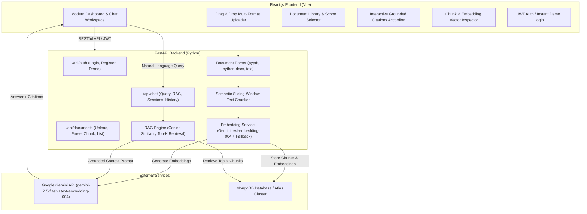

# DocuMind AI — AI Document QA Assistant

An enterprise-grade, full-stack AI Document QA Assistant built with **React.js**, **FastAPI (Python)**, **MongoDB**, **Google Gemini API**, and **Retrieval-Augmented Generation (RAG)**. Enables users to upload PDF, DOCX, and TXT files and interact with their documents through natural-language queries with verified, grounded citations.

---

## 🚀 Key Highlights & Resume Summary

* **AI-Powered Multi-Format Document Ingestion:** Built with React.js and FastAPI, supporting direct upload and extraction for `.pdf` (via `pypdf`), `.docx` (via `python-docx`), `.txt`, `.md`, and `.csv` files.
* **Production RAG Pipeline:** Implemented intelligent sliding-window semantic chunking (preserving sentence and paragraph boundaries), dense vector embeddings (`text-embedding-004` + resilient fallback vectorizer), and cosine similarity search to retrieve top-$k$ contextual excerpts.
* **Grounded LLM Responses via Gemini API:** Formulates executive prompts with retrieved context chunks, enforcing strict grounding to prevent hallucinations while providing transparent source citations (document title, page number, relevance score, snippet).
* **MongoDB-Backed Persistence:** Complete user authentication (bcrypt + JWT), document metadata & chunk storage, and multi-turn chat conversation history with RESTful APIs. Includes an automatic local persistence engine for zero-friction setup even when an external MongoDB server is not active.

---

## 🏛️ System Architecture



---

## 🛠️ Tech Stack

| Layer | Technologies |
|---|---|
| **Frontend** | React 19, Vite, Lucide Icons, React-Markdown, Modern CSS3 with Glassmorphism |
| **Backend** | FastAPI, Uvicorn, Python 3.11+, Pydantic v2 |
| **AI / RAG** | Google Gemini API (`google-genai`), `text-embedding-004`, `gemini-2.5-flash`, NumPy |
| **Document Processing**| `pypdf` (PDF extraction), `python-docx` (DOCX & tables), UTF-8 / multi-encoding TXT |
| **Database** | MongoDB (`motor` async driver, `pymongo`), auto-fallback persistent store |
| **Security & Auth** | JSON Web Tokens (`pyjwt`), Bcrypt password hashing |

---

## 📂 Project Directory Structure

```
AI Document QA Assistant/
├── backend/
│   ├── app/
│   │   ├── config.py             # Environment variables and Pydantic settings
│   │   ├── database.py           # MongoDB connection & resilient fallback engine
│   │   ├── main.py               # FastAPI app, CORS, lifespan, routes
│   │   ├── models/
│   │   │   ├── user.py           # Auth, User, and Token schemas
│   │   │   ├── document.py       # Document metadata and Chunk schemas
│   │   │   └── chat.py           # Query, Citation, and Session schemas
│   │   ├── routers/
│   │   │   ├── auth.py           # Registration, Login, Demo user endpoints
│   │   │   ├── documents.py      # Upload, list, inspect chunks, delete
│   │   │   └── chat.py           # RAG query, conversation sessions, status
│   │   └── services/
│   │       ├── auth_service.py   # JWT token creation and bcrypt verification
│   │       ├── document_parser.py# PDF, DOCX, and TXT parsing
│   │       ├── chunker.py        # Semantic sliding-window chunker
│   │       ├── embedding_service.py # Gemini embeddings & vector similarity
│   │       ├── rag_service.py    # Semantic search & grounded LLM generation
│   │       └── chat_service.py   # Multi-turn conversation persistence
│   ├── run.py                    # Backend server runner
│   └── sample_documents/         # Ready-to-use sample PDF, DOCX, and TXT files
├── frontend/
│   ├── src/
│   │   ├── components/
│   │   │   ├── Header.jsx        # Branding, live status chips, user menu
│   │   │   ├── Sidebar.jsx       # Document list, drag-and-drop, sessions
│   │   │   ├── ChatArea.jsx      # Markdown chat, Grounded Citations Accordion
│   │   │   ├── ChunkInspectorModal.jsx # Visual inspector for document chunks
│   │   │   ├── SettingsModal.jsx # Gemini API key setup and diagnostics
│   │   │   └── AuthModal.jsx     # Login, Register, Instant Demo modal
│   │   ├── context/
│   │   │   └── AuthContext.jsx   # Auth provider with token and API key sync
│   │   ├── services/
│   │   │   └── api.js            # Frontend REST API client
│   │   ├── App.jsx               # Root application layout and state
│   │   ├── index.css             # Polished modern theme with Glassmorphism
│   │   └── main.jsx
│   ├── index.html
│   └── vite.config.js
├── start.sh                      # Unified one-command launch script
├── test_backend.py               # Unit & integration test suite
├── test_api_client.py            # End-to-end REST API validation suite
├── requirements.txt              # Python dependencies
├── .env.example                  # Environment configuration template
└── README.md
```

---

## ⚡ Quick Start Guide

### 1. Prerequisites
- **Python 3.10+** (tested through Python 3.14)
- **Node.js 18+** and **npm**
- *(Optional)* **MongoDB** (Local `mongod` or MongoDB Atlas URI). If MongoDB is offline, the application seamlessly uses its built-in local persistent store.
- *(Optional)* **Gemini API Key** from [Google AI Studio](https://aistudio.google.com/). You can add it to `.env` or input it directly via the Settings modal in the UI.

### 2. Configure Environment (Optional)
```bash
cp .env.example .env
```
Edit `.env` to provide your `GEMINI_API_KEY` or `MONGODB_URI`:
```ini
GEMINI_API_KEY=your_gemini_api_key_here
MONGODB_URI=mongodb://localhost:27017
MONGODB_DB_NAME=doc_qa_assistant
```

### 3. Launch Both Servers
Run the unified launch script:
```bash
./start.sh
```

Or run them in separate terminals:

**Terminal 1 (Backend):**
```bash
python3 -m venv .venv
source .venv/bin/activate
pip install -r requirements.txt
python backend/run.py
```
> FastAPI will start on **http://127.0.0.1:8000** (Interactive Swagger docs available at **http://127.0.0.1:8000/docs**).

**Terminal 2 (Frontend):**
```bash
cd frontend
npm install
npm run dev
```
> React Vite app will start on **http://127.0.0.1:5173**.

---

## 🧪 Testing the RAG Pipeline

You can run the automated test suite at any time:

```bash
# 1. Run unit tests (Chunking, Parsing, Embeddings, Database)
.venv/bin/python test_backend.py

# 2. Run end-to-end REST API tests (Uploads, Citations, Sessions)
.venv/bin/python test_api_client.py
```

### Interactive Walkthrough in the UI:
1. Open **http://127.0.0.1:5173** in your browser.
2. Click **"Load Sample Documents"** (or drag and drop your own PDF, DOCX, or TXT file).
3. The files will be parsed, segmented into semantic chunks, and embedded into high-dimensional vector space.
4. Click the **Layers icon** on any document card to open the **Chunk & Embedding Inspector**.
5. Ask natural-language questions such as:
   - *"What is the RAG architecture and its key advantages?"*
   - *"What compliance frameworks were certified in the security report?"*
   - *"What is the remote work equipment allowance?"*
6. Review the grounded markdown answer and expand the **"Grounded Sources"** accordion to verify exact page numbers, similarity match percentages, and source snippets.

---

## 📡 REST API Reference

| Method | Endpoint | Description |
|---|---|---|
| `GET` | `/api/health` | Health check and system connection diagnostics |
| `POST` | `/api/auth/register` | Register new user with username, email, and password |
| `POST` | `/api/auth/login` | Authenticate user and receive JWT bearer token |
| `POST` | `/api/auth/demo` | Instant demo login for evaluation |
| `GET` | `/api/auth/me` | Fetch authenticated user profile |
| `POST` | `/api/documents/upload` | Upload PDF/DOCX/TXT; triggers parsing, chunking, and vector embedding |
| `GET` | `/api/documents` | List all documents belonging to current user |
| `GET` | `/api/documents/{id}/chunks` | Inspect text chunks and metadata for a specific document |
| `DELETE` | `/api/documents/{id}` | Delete document and its corresponding chunk vectors |
| `POST` | `/api/chat/query` | Execute RAG pipeline: retrieves top-k chunks, generates grounded answer, saves history |
| `GET` | `/api/chat/sessions` | List user conversation sessions |
| `GET` | `/api/chat/sessions/{id}/messages` | Retrieve conversation turn history and citations |
| `DELETE` | `/api/chat/sessions/{id}` | Delete a conversation session |
| `GET` | `/api/chat/status` | Retrieve database connection and Gemini API status |
